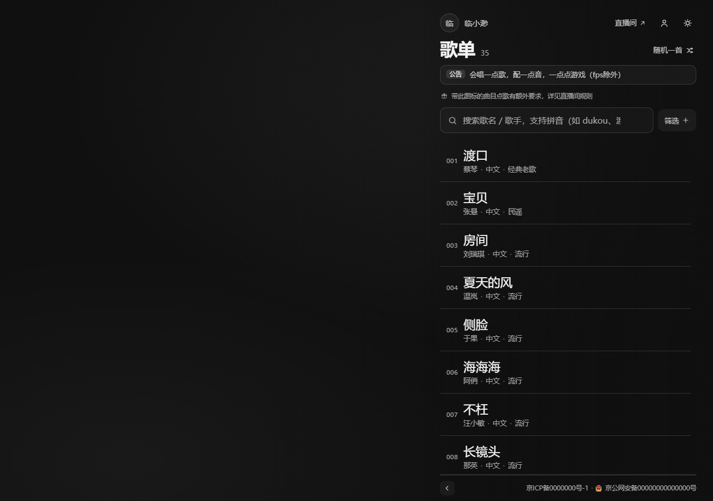
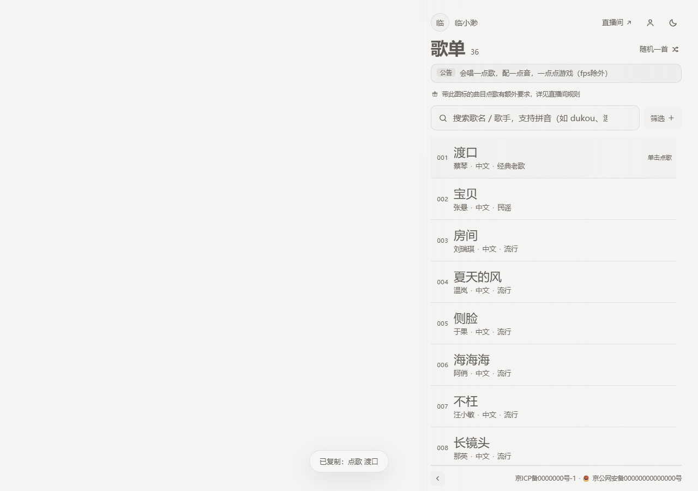
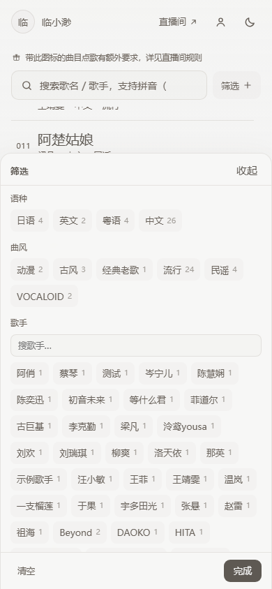
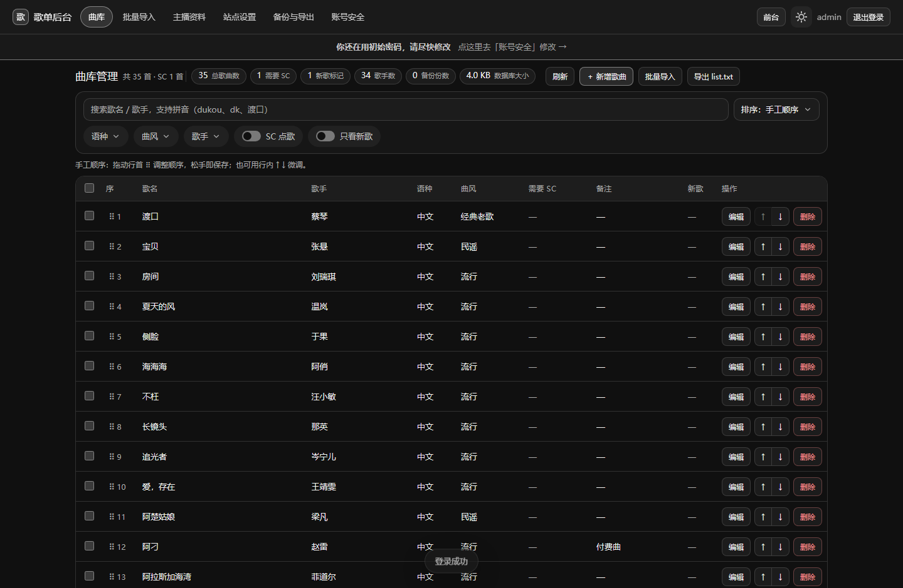
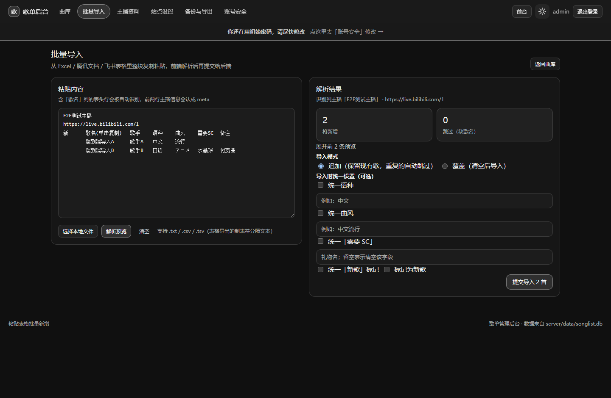

# 歌单点歌站（Vue 3 + Vite + Node + SQLite）

模仿 [yybb.vsinger.ink](http://yybb.vsinger.ink/)（VioletBlue 系歌单站）做的**单主播点歌站 + 在线管理后台**。
观众打开就能搜歌、筛分类、点一下就复制好点歌文本；主播在后台随时改歌、改公告、改简介，前台立刻生效。

```
浏览器 ──> Node 服务（一个进程）
              ├── 前台        /            观众看的歌单
              ├── 后台        /admin       管理界面
              ├── 接口        /api/*
              └── 图片        /uploads/*
         数据：SQLite 单文件（server/data/songlist.db）+ 自动备份
```

---

## 界面预览

下面的图是实际跑起来截的（`pnpm e2e` / `pnpm e2e:admin` 的产物在 `.shots/`，这几张是挑出来放进 `docs/screenshots/` 的）。

**前台**






**后台**




---

## 快速开始（本地开发）

```bash
pnpm install
pnpm dev:all          # 同时起后端(5181)和前端(5180)，Ctrl+C 一起退
```

| 地址 | 是什么 |
| --- | --- |
| http://127.0.0.1:5180/ | 前台歌单 |
| http://127.0.0.1:5180/admin.html | 管理后台 |
| http://127.0.0.1:5181/ | 后端直接提供的同款页面（生产形态） |

也可以分开跑：

```bash
pnpm dev              # 只起前端（会把 /api 代理到 5181）
pnpm dev:server       # 只起后端（改代码自动重启）
```

**首次启动会打印一次管理员密码**（只显示这一次，数据库里只存 scrypt 哈希）：

```
· 已创建管理员账号：admin / xxxxxxxxxxxx
```

登录后请去后台「账号安全」改掉。忘记密码：

```bash
pnpm reset-password                          # 交互式，不回显
pnpm reset-password --generate               # 生成随机密码
```

---

## 后台能做什么

| 模块 | 功能 |
| --- | --- |
| 曲库管理 | 增删改（歌名/歌手/语种/曲风/需要SC/备注/新歌标记）、按拼音搜索、分面筛选、分页、多选批量删除、置顶/置底、上下移动、**拖拽排序** |
| 批量导入 | 从 Excel / 腾讯文档 / 飞书表格**直接整块粘贴**，自动识别列，预览后导入；支持「追加」与「覆盖」（覆盖前自动备份） |
| 主播资料 | 简介、副标题、标签、链接、四种内容块（公告/文本/列表/键值）、头像与封面（填 URL 或上传图片） |
| 站点设置 | 主播名、直播间链接、ICP 备案号、公告 |
| 备份与导出 | 自动备份列表、手动备份、一键回滚、下载备份、导出 `list.txt` / 完整 JSON、操作日志 |
| 账号安全 | 改密码（改完踢掉其他设备），初始密码未改时全程提醒 |

安全设计：

- 密码只以 **scrypt 哈希**（16 字节随机盐、64 字节密钥）存库，比较用 `timingSafeEqual`；数据库文件、备份、导出里都**没有**明文，也没有 users 表外流；
- 会话是 32 字节随机 id，放在 `HttpOnly` + `SameSite=Lax` cookie 里，可开 `Secure`；
- 登录失败按 IP 限流（10 分钟 8 次）；
- 所有写操作前自动备份（同类 5 分钟内合并），覆盖导入/清空/回滚**必定**单独备份；
- 管理接口写操作全程记审计日志。

---

## 换歌单（三条路，任选）

1. **后台导入**（推荐）：后台 → 批量导入 → 粘贴表格内容 → 选「覆盖」→ 二次确认。
2. **改静态文件**：直接替换 `public/list.txt` 与 `public/profile.json`，重启后端会重新灌入（仅当库是空的）。
3. **命令行**：

```bash
pnpm data --status                                        # 看统计
pnpm data --import 我的歌单.txt --replace --yes \
          --streamer "主播名" --live "https://live.bilibili.com/xxx"
pnpm data --clear-songs --yes                             # 清空曲库（先自动备份）
```

> 歌曲字段、语种、曲风的**取值全部来自数据本身**，代码里没有写死任何语种或分类，换成别的语言体系一样能用。

### list.txt 格式

前两行是主播信息，第三行是列名，之后每行一首歌：

```
主播名
https://live.bilibili.com/21465419
新	歌名(单击复制)	歌手	语种	曲风	需要SC	备注
	渡口	蔡琴	中文	中文流行
	吉祥话	泠鸢yousa/Hanser	中文	中文流行	星愿水晶球
```

- 列名里的关键词会被自动识别（`歌名 / 歌手 / 语种 / 曲风 / SC / 备注`），**列顺序可以调整**。
- 第一列的 `新` 标记会显示成「新」角标。
- `需要SC` 列填了内容（比如礼物名）就会打上 SC 标记，并参与「SC 点歌」筛选。
- **只有整行完全一致**才会被当作重复跳过；仅仅"歌名+歌手"相同会照常导入并给出「疑似重复」提示，绝不悄悄丢你的数据。
- 表格「导出为 txt / TSV」，或者从表格软件里复制整块粘贴，都能被识别。

### profile.json 格式

```json
{
  "title": "副标题",
  "bio": "一句话简介",
  "avatar": "头像图片地址（可选）",
  "cover": "弹窗顶部封面图地址（可选）",
  "tags": ["歌势", "标签"],
  "links": [{ "label": "B 站主页", "url": "https://..." }],
  "blocks": [
    { "type": "notice", "title": "点歌提示", "content": "规则文本" },
    { "type": "list", "title": "适合点歌", "items": ["华语流行"] },
    { "type": "kv", "title": "直播信息", "items": [{ "label": "平台", "value": "Bilibili" }] },
    { "type": "text", "title": "自我介绍", "content": "长文本" }
  ]
}
```

后台可以直接编辑这些字段，不用手写 JSON。

---

## 前台功能

- **搜索**：歌名、歌手、拼音全拼、拼音首字母四路匹配 —— `渡口`、`dukou`、`dk` 都能搜到同一首。
- **筛选**：语种 / 曲风 / 歌手（多选，带分面数量）/ 是否 SC 点歌。
- **点歌**：单击任意一行复制 `点歌 歌名`（不带歌手）（**「点歌」后面是半角空格**，直播间的点歌机按这个前缀识别，用全角冒号会识别不到）；带 SC 的会补上 `（礼物名）`。格式在 `src/config.ts` 的 `copyTemplate` 里改。
- **虚拟滚动**：只渲染视口内约 20 行，几千首也不卡。
- **主题**：暗色 / 亮色，记住选择；`?theme=light` 可强制指定，`#profile` 可直接打开简介弹窗。
- **公告**：后台填的公告会显示在搜索框上方；填了 ICP 会显示在页脚。
- **移动端**：筛选弹层贴底、行高加大、次要列隐藏。

### 数据来源：接口优先，自动回退

前台启动时先请求 `GET /api/songs`：

- 拿到了 → 页脚显示「数据来自后台」，实时反映后台的改动；
- 拿不到（后端没起、纯静态托管、Nginx 没转发 `/api`）→ 自动退回读静态 `list.txt`，页脚显示「数据来自 list.txt」。

所以这套代码**既能带后台部署，也能当纯静态站扔到 GitHub Pages / Cloudflare Pages**，不需要改代码。
后端每次写库后都会把 `dist/list.txt` 和 `dist/profile.json` 同步再生一遍，静态回退看到的永远是最新数据。

---

## 自检脚本

```bash
pnpm verify       # 数据管道：解析 list.txt、统计语种/曲风、校验拼音搜索
pnpm test:api     # 后端接口：63 项（鉴权、CRUD、导入去重、排序、备份回滚、导出、密码安全…）
                  #   在临时目录起独立实例，跑完自动清理，不碰你的真实数据
pnpm e2e          # 前台端到端：20 项，Chrome DevTools Protocol 真点，含「接口挂掉回退静态」
pnpm e2e:admin    # 后台端到端：登录、增删改、批量导入、拖拽排序、备份回滚
```

`pnpm e2e` 需要前端 dev server 已在跑；截图落在 `%TEMP%\songlist-e2e`，
`docs/screenshots/` 里是 README 用的那几张参考图。

---

## 目录结构

```
index.html / admin.html      两个入口：前台、后台
src/
  config.ts                  数据源地址、文案、点歌格式
  types.ts
  utils/parse.ts             list.txt -> 歌曲数组（前台粘贴导入也用它）
  utils/search.ts            拼音检索索引
  utils/loadText.ts          带超时的请求
  composables/               useSongList / useVirtualList / useTheme / useToast / useClipboard
  components/                前台组件
  admin/                     后台界面（api.ts + views/ + components/）
server/
  index.mjs                  后端入口（静态资源 + API + 启动自检）
  routes.mjs                 全部接口
  API.md                     ★ 接口契约
  lib/                       db / auth / backup / export / http / importList
  data/                      运行时数据（数据库、备份、上传）—— 唯一要备份的目录
scripts/
  api-test.mjs               接口自检
  e2e.mjs / e2e-admin.mjs    端到端自检
  verify.ts                  数据管道自检
  reset-password.mjs         改密码 / 忘记密码
  reset-data.mjs             换歌单 / 清空 / 导入
  dev-all.mjs                同时起前后端
deploy/                      systemd、Nginx、env 模板、一键安装脚本
DEPLOY.md                    ★ 部署到 1Panel / Linux 服务器的完整步骤
```

---

## 部署

完整步骤见 **[DEPLOY.md](DEPLOY.md)**（1Panel + Nginx + systemd，含 Docker 方案、备份策略、升级流程、安全清单、排障表）。
最省事的一条命令：

```bash
sudo bash deploy/install.sh /path/to/songlist-source
```

---

## 当前状态

`public/list.txt` 里是**示例数据**（779 首，取自线上公开歌单，主播名已替换为占位），
`public/profile.json` 是**占位简介**。后台的「批量导入 → 覆盖」或 `pnpm data --import ... --replace`
可以随时换成你自己的歌单，代码不用动。

---

## 许可证

[MIT](LICENSE) © 2026 TransForm-sys

> 说明：仓库里的 `public/list.txt` 默认是**示例歌单**。换成自己的歌单请走后台「批量导入 → 覆盖」，
> 或 `node scripts/reset-data.mjs --import <文件> --replace`。
> 部署文档里的域名 / IP / 备案号均为占位示例，请替换成你自己的。